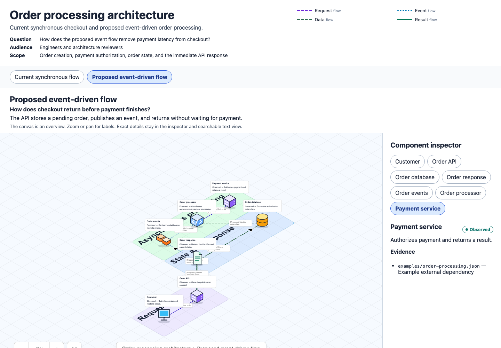

# Pisoflow

Pisoflow is a [Pi](https://github.com/badlogic/pi-mono) skill that turns code evidence and architecture descriptions into interactive, self-contained [Isoflow](https://github.com/markmanx/isoflow) documents.



Each document includes:

- an explorable isometric canvas with derived layout
- accessible view tabs and component inspection
- semantic statuses and source evidence
- focused current, proposed, migration, or decision views
- a complete searchable text alternative
- embedded open-source license notices

Pisoflow is independent and is not affiliated with Isoflow.

## Install

Install the pinned release:

```bash
pi install git:github.com/maxsumrall/pisoflow@v0.2.0
```

Review the source before installation. Pi skills can instruct the agent to run local programs.

## Use with Pi

```text
Use Pisoflow to show the current and proposed order-processing architecture.
```

The skill inspects relevant evidence, writes semantic JSON to a temporary location, and runs the renderer directly with Node. It does not add a diagram source file to the inspected repository.

## Render directly

Rendering requires Node.js 22.12 or newer. It does not require npm, Vite, React tooling, a server, or network access.

```bash
node skills/pisoflow/scripts/render.mjs examples/order-processing.json --output=order-processing --open
```

The renderer creates a unique directory below:

```text
~/.agent/diagrams/pisoflow/
```

It returns the generated `index.html` path before it tries to open a browser. Each document is one offline HTML file.

## Diagram format

See [`skills/pisoflow/references/schema.md`](skills/pisoflow/references/schema.md). Source documents contain architecture meaning, evidence, ordered groups, and view membership. The renderer validates the document and deterministically derives coordinates, regions, line styles, colors, and the legend.

The renderer rejects unknown references, duplicate identifiers, repeated group membership, view-external edge endpoints, malformed semantic values, and unsafe output names.

## Runtime safety

- Output names cannot contain paths.
- Each render owns a unique output directory.
- Concurrent renders do not share data or output directories.
- Diagram JSON is UTF-8 Base64 inside a non-executable payload element.
- Text such as `</script>` cannot alter the generated document.
- The renderer uses argument arrays for optional browser opening.
- A browser-open failure does not remove or invalidate the output.

## Development

Install the small runtime and isolated build tooling separately:

```bash
npm ci
npm --prefix tooling ci
npx --prefix tooling playwright install chromium
```

Run validation:

```bash
npm run audit
npm test
npm --prefix tooling run audit
npm --prefix tooling test
npm --prefix tooling run build-template
git diff --exit-code -- skills/pisoflow/assets/template.html
```

`tooling/` owns React, Isoflow, Vite, and browser-test dependencies. A release build writes the self-contained application to [`skills/pisoflow/assets/template.html`](skills/pisoflow/assets/template.html). Runtime rendering reads that committed template and injects one validated Base64 payload. Pi package installation therefore installs only the runtime validator dependency.

## Licensing

Pisoflow is available under the MIT license in [`LICENSE`](LICENSE).

Isoflow Community Edition is an MIT-licensed build dependency. Its full notice is in [`THIRD_PARTY_NOTICES.md`](THIRD_PARTY_NOTICES.md) and is embedded in every generated HTML document. Notices supplied with Isoflow's distribution bundle are preserved in [`licenses/isoflow-bundle-notices.txt`](licenses/isoflow-bundle-notices.txt). Complete generated-document notices are in [`licenses/generated-document-notices.txt`](licenses/generated-document-notices.txt).

Pisoflow does not depend on or redistribute `@isoflow/isopacks`. Its generic SVG icons are original Pisoflow assets.
